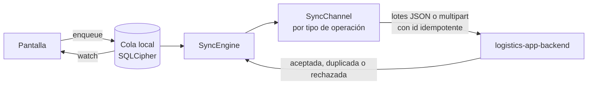

# Logistics Mobile

[](https://github.com/jordantx-logistics/logistics-app-mobile/actions/workflows/ci.yml)


Cuatro apps Android **offline-first** para la operación de una empresa logística, sobre un paquete común. Todo lo que se captura se guarda primero en el equipo y se sincroniza cuando hay red, sin duplicar ni perder nada.

Consumen el API de [logistics-app-backend](https://github.com/jordantx-logistics/logistics-app-backend) (Laravel 13). El backoffice web es [logistics-app-frontend](https://github.com/jordantx-logistics/logistics-app-frontend) (Vue 3).

> 🇺🇸 *Four offline-first Android apps (warehouse, fleet, last-mile delivery and staff attendance) built with Flutter on a shared core: an encrypted local database, an idempotent outbox and a conflict-aware sync engine. Personal project.*

## Apps

| App | Para quién | Qué hace |
| --- | --- | --- |
| `pda` | Almacén | Recepción, embarque, desembarque, inventario y salida a reparto, con la cámara o un lector tipo teclado |
| `flota` | Chofer | Rutas, tramos, kilometraje, viáticos y combustible con comprobante |
| `reparto` | Última milla | Hoja de ruta, entrega con firma, foto y GPS, y motivos de no entrega |
| `corporativa` | Empleado | Marcaciones de asistencia |

## Arquitectura

```
apps/{pda,flota,reparto,corporativa}   Pantallas y canales de sincronización de cada app
packages/logistics_core                Sesión, PIN, cliente API, base cifrada y motor de sincronización
tool/                                  Contrato, cobertura, permisos de Android y E2E
```



### Sincronización

| Situación | Qué ocurre |
| --- | --- |
| Orden | Sale como máximo una operación por entidad en cada envío. Si una espera o tiene conflicto, retiene las siguientes de esa entidad y no bloquea a las demás. |
| Sin red o error 5xx | Se reintenta sin tope, con espera exponencial y desfase aleatorio, para que los equipos no reintenten a la vez al volver la señal. |
| Respuesta perdida | El id de la operación es su clave de idempotencia: reenviarla no la duplica. |
| Rechazo de negocio | Queda como conflicto visible. El servidor es la verdad; la app no corrige por su cuenta. |
| Sesión revocada | El envío se detiene sin perder la cola, que sale al volver a entrar. |
| Firmas, fotos y comprobantes | Viven en disco hasta que el servidor confirma. |

### Seguridad

- Base local cifrada con **SQLCipher**. Si el cifrado no está disponible, la app se niega a guardar datos.
- El token y la clave de la base (256 bits) se guardan con el **Keystore** de Android.
- PIN local: solo se guarda su derivación con sal. Cinco fallos lo bloquean un minuto, y el bloqueo sobrevive a reiniciar la app.
- Las compilaciones de release solo aceptan un API HTTPS.

### Contrato con el backend

Las rutas del API se generan desde el OpenAPI del backend (`tool/gen_contract.dart`). El CI falla si una ruta que usan las apps desaparece del contrato.

## Calidad

- **46 tests** del paquete común. La sincronización cubre el **98,6 %** de las líneas (CI de `develop`); el CI exige al menos 80 %.
- **17 pruebas de integración** en emulador (almacenamiento cifrado, y flujos completos contra el backend en un stack aislado), entre ellas 500 escaneos sin red que se sincronizan sin duplicados. Se ejecutan a mano; el CI no las corre.
- CI en GitHub Actions: formato, análisis estático, deriva del contrato, tests, cobertura y compilación de las cuatro apps.

## Arranque

Requiere Flutter 3.38 y el backend.

```bash
flutter pub get

# Tests del paquete común
cd packages/logistics_core && flutter test

# Una app en el emulador, desde la raíz del repositorio
cd apps/pda
flutter run --dart-define=API_BASE_URL=http://10.0.2.2:8100
```

El puerto 8100 es el del stack E2E del backend (`sh scripts/e2e-up.sh` en su repositorio). Los demás comandos y las convenciones están en [AGENTS.md](AGENTS.md).

## Estado y límites

Proyecto personal de aprendizaje; no está en producción.

- Solo Android. La firma de release sigue siendo la de depuración.
- La lectura por cámara, el GPS y los lectores físicos (Zebra, Honeywell) no los cubren los tests, y falta probar en un equipo físico.
- El contrato genera rutas, no modelos.
- Las fuentes se descargan con `google_fonts` en el primer arranque con red; falta empaquetarlas. No hay modo oscuro.

## Licencia

[MIT](LICENSE)
